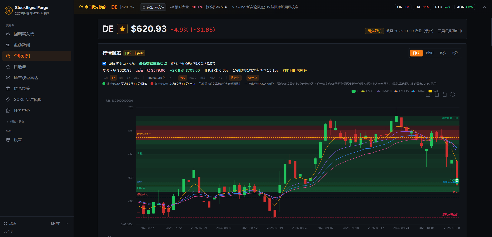
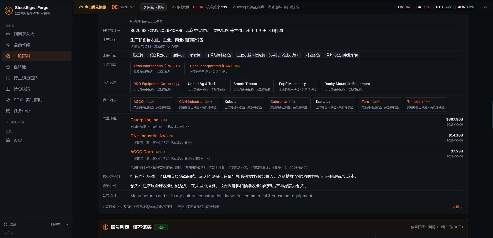

# StockSignalForge

**easymoneysniper**

**English** | [中文](README_zh.md) | [日本語](README_ja.md) | [한국어](README_ko.md) | [العربية](README_ar.md)

[](https://github.com/JohnCharlesFields/StockSignalForge/actions/workflows/test.yml)

An AI stock research workbench built on [HKUDS/Vibe-Trading](https://github.com/HKUDS/Vibe-Trading). Quotes, news, pullback candidate screening, single-stock analysis, position review and strategy backtesting in one workspace.

> **Market focus: US equities and US-listed equity options. Mainland China A-shares and Hong Kong stocks are still being adapted.** Existing upstream adapters do not mean the entire research, calendar, data and validation workflow is supported for those markets.

## Market Coverage

| Market | Current scope |
| --- | --- |
| US equities | Main research workflow: daily candidates, charts, company context, news, watchlists and strategy research |
| US equity options | Direction research, available IV/Greeks and manually calculated 60–90 DTE Call contract/exit scenarios, subject to data permissions and quality |
| A-shares | Adaptation in progress; not a fully supported end-to-end workflow |
| Hong Kong stocks | Adaptation in progress; not a fully supported end-to-end workflow |

Research output is not a guaranteed buy/sell recommendation. This branch does not connect to a broker or submit live orders. SOXL execution experiments are simulations, not a live trading service.

## Research Workspace

| Module | Purpose |
| --- | --- |
| Pullback board | Rank cached candidates, track their lifecycle and reconcile predictions with subsequent outcomes |
| Single-stock analysis | Candlesticks, trend structure, causal research markers, company/industry context, supply-chain references and risk levels |
| Options research | Distinguish Call/Put/observe directions; inspect available volatility data and compare contract/exit scenarios without inventing missing quotes |
| News and creator radar | Prioritized news cards/list, recent-news summaries and transcript-based creator opinions with explicit source/availability states |
| Watchlist and positions | Maintain research coverage, review positions and compare dated evidence |
| Three-layer signals | Opportunity quality, launch timing/tunnel structure, event risk and qualified GEX evidence |
| Validation and tasks | Factor studies, backtests, versioned forward evidence, scheduled scans, checkpoints and cache freshness |

Features depend on the configured data sources. An unavailable IV, OI, volume, transcript, earnings date or historical membership remains unknown, not zero or fabricated evidence.

## Interface Preview





Screenshots are historical research snapshots, not return verification. See the [full gallery](SCREENSHOTS.md). Documentation languages do not imply that every application screen has been translated.

## Docker Quick Start

Use Docker Engine/Compose or Docker Desktop in Linux-container mode. Run at the repository root; do not overwrite an existing private environment file.

```powershell
if (!(Test-Path agent/.env)) { Copy-Item agent/.env.example agent/.env }
# Configure agent/.env locally before starting the application.
docker compose up -d --build vibe-trading
```

Open [the workbench](http://127.0.0.1:19090). Check [service health](http://127.0.0.1:19090/health).

```sh
docker compose logs --tail 100 vibe-trading
docker compose stop vibe-trading
```

The published port is bound to localhost by default. Remote access requires authentication and explicitly trusted origins.

### Updating an Existing Installation

Wait for scans, calibration, enrichment and other active jobs to finish. Back up the existing SQLite database with its online backup API and preserve the named volumes before replacement.

```sh
docker compose build vibe-trading
docker compose up -d --no-deps vibe-trading
```

Do not use `docker compose down -v`. Cloning this repository does **not** copy historical databases, caches, private configuration or Cookies; migrate those separately using a consistent backup.

## Data and Private Configuration

| Setting | Local configuration |
| --- | --- |
| Model provider | `agent/.env`: `LANGCHAIN_PROVIDER`, `LANGCHAIN_MODEL_NAME` and your provider credentials |
| GilData MCP | `GILDATA_MCP_URL` and `GILDATA_MCP_TOKEN`, supplied separately; see the [integration guide](GILDATA_MCP.md) |
| Other market-data providers | Your own API keys and provider-specific entitlements |
| API authentication | `API_AUTH_KEY`; do not expose an unauthenticated private installation |
| External MCP tools | Start with `config/agent.example.json` and `config/mcp-client.example.json` |

GilData is an optional evidence source, not an endorsement of model returns. A data plan may cover stocks without covering OPRA options. Quote dates and fallback-source status matter.

Credentials, authenticated MCP URLs, Cookies, databases, historical provider datasets and private training annotations are not distributed. Optional background refresh/training features require explicit configuration; public defaults do not automatically activate a new model.

## Probability and Backtest Boundaries

- Research scores, calibrated equity probabilities, net-positive trade ratios, SPY-relative alpha and option profitability probabilities are different measures.
- A directionally correct equity forecast can still produce an option loss because of premium, bid/ask spreads, time decay and IV changes. Scenario tables are not probability-weighted expected values.
- Experimental v-swing/long/short markers are not proof of profitable execution. Confirmed daily signals must not assume a fill at an already observed closing price.
- Corporate-action units, actual information availability, historical membership and complete event revisions require explicit evidence. Missing evidence blocks certification.
- Strict 5/8-session calibration rebuilding found insufficient time-verified historical samples; no replacement curve was activated. Existing numeric curves remain unverified research references.
- Recomputed fixed-rule historical comparisons did not establish stable positive expectancy. Previously inspected history is not an untouched holdout, and passing software tests does not prove absence of all leakage or overfitting.

## Updates and Verification

The October 20 update hardened corporate-action accounting and temporal evidence, and repaired CI fixture imports, synthetic test data, calendar determinism and SDK exception compatibility.

The published `162054e` revision passed GitHub CI: **3,321 tests and 45 subtests passed; 2 existing skips**. Use the live badge above for the current revision, not as evidence of trading profitability.

- [Changelog](CHANGELOG.md)
- [Test/configuration audit](PUBLIC_RELEASE.md) (Chinese)
- [Latest detailed evidence and bug-fix notes](wiki/RELEASE_20261020_ZH.md) (Chinese)
- [Experimental swing methodology](wiki/V_SWING_RESEARCH_ZH.md) (Chinese)
- [Call scenario methodology](wiki/CALL_PLAN_RESEARCH_ZH.md) (Chinese)

## Development

Python 3.11+ and Node.js 20+; configure development API routing with `VITE_API_URL`.

```sh
python -m pip install -e ".[dev]"
pytest --ignore=agent/tests/e2e_backtest --ignore=agent/tests/test_e2e_harness_v2.py --tb=short -q
cd frontend
npm ci
npm run build
```

Real-model end-to-end tests require separate explicit opt-in and valid credentials. Never use production data volumes for isolated tests.

## Attribution and License

Built on [HKUDS/Vibe-Trading](https://github.com/HKUDS/Vibe-Trading). Retained upstream references: [English](README.upstream.md) and [Chinese](README_zh.upstream.md).

[MIT License](LICENSE), with third-party notices in [NOTICE](NOTICE). The software license does not grant access to a data service or permission to redistribute its data.
